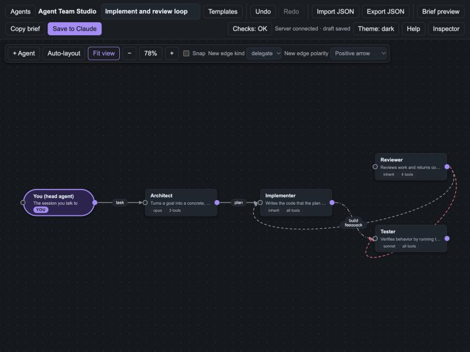

# Agent Team Studio

**Draw a team of Claude agents, save it, and apply it to any prompt with one command.**

Designing a team of agents gets messy fast: who does what, who reviews whom, what gets handed over and when. Agent Team Studio is a small Claude Code plugin with a visual editor. You place agents on a canvas, connect them with described edges, and save the result. Then `/teams:run` turns the drawing into instructions Claude follows.



- **Nodes are agents.** Each has a name, a role, instructions, a model and a tool list.
- **Edges say how two agents interact.** Each has a type, a short label and a description of the protocol.
- **Profiles and templates.** Save a single agent as a profile, or a whole team as a template, and reuse them in a click.
- **One command to apply it.** `/teams:run <team> <your task>` hands Claude a structured brief and has it spawn the agents.
- **Zero dependencies.** Plain Node 20 or newer. No npm install, no build step, and the editor and its server run entirely on your machine.

## Install

You need [Claude Code](https://claude.com/claude-code) and Node 20 or newer (`node --version`).

**From GitHub**, inside Claude Code:

```
/plugin marketplace add SeanMisek/zerg
/plugin install teams@team-studio
```

If the repository is private, you need access to it first.

**From a local clone:**

```sh
git clone git@github.com:SeanMisek/zerg.git
claude --plugin-dir ./zerg
```

Run `/reload-plugins` after editing plugin files.

## Quick start

```
/teams:edit                                   open the visual editor
/teams:list                                   list your saved teams
/teams:load add a --dry-run flag              pick a saved team from a list, then run it on this task
/teams:run review-loop add a --version flag   run a named team directly
/teams:new a team that drafts a grant section and has a skeptical reviewer
/teams:agents review-loop                     write real .claude/agents/*.md files for a team
```

Three starter teams are installed the first time you use it: an implement-and-review loop, a fan-out/fan-in research team, and a plan-build-test pipeline. Try `/teams:run review-loop <a small coding task>` to see the idea end to end.

## Using the editor

`/teams:edit` starts a small local server and opens the editor in Claude's built-in browser pane. In a plain terminal it prints the address (`http://127.0.0.1:4317/`) so you can open it in any browser.

| To do this | Do this |
|---|---|
| Add an agent | **+ Agent**, or click a saved profile in the **Agents** palette |
| Connect two agents | Drag from the right-hand dot of one agent onto another |
| Describe an interaction | Click an edge, then fill in its type, label and protocol |
| Edit an agent | Click it, then use the inspector: name, role, instructions, model, tools |
| Reuse an agent later | **Save as profile** in the inspector |
| Save the whole team | **Save to Claude** (asks before replacing a saved team of the same name) |
| Load or duplicate a team | **Templates** |
| See what Claude will receive | **Brief preview** (and **Copy brief**) |
| Undo or redo | Cmd/Ctrl+Z and Cmd/Ctrl+Shift+Z |
| Pan and zoom | Drag the background (or hold Space and drag), mouse wheel to zoom |
| Share a team as a file | **Export JSON** / **Import JSON** |

The editor opens in dark mode; the **Theme** button cycles dark, light and system. The **Checks** badge points out problems such as unconnected agents.

### Edge types

| Type | Meaning |
|---|---|
| `delegate` | From assigns work to To and waits for the result |
| `handoff` | From finishes, then passes its output to To as input (a pipeline step) |
| `review` | From reviews To's output and returns concrete feedback; To revises, up to a set number of rounds |
| `consult` | From may ask To questions; the answer comes back |
| `debate` | Both state a position, then reconcile; the lead decides ties |

### Two drawing aids

- **Head agent ("you").** Add **You (head agent)** from the palette to show yourself, the session you type your prompt into. It is never spawned as a subagent: its notes become the lead's standing instructions, and its edges show who you delegate to. One per team.
- **Positive and negative edges.** An edge can be drawn as an arrow or as an inhibitor bar (select an edge and press **P**). This is for illustration only. It is saved with the team, but it never changes the brief or anything Claude does.

## What happens when you run a team

`/teams:run` compiles the drawing into a Markdown brief with these parts: how to run the team, a roster of agents with their instructions, the interactions in a suggested order, and your task. Claude then spawns each agent with its normal Agent tool and follows the edges you drew. You can read the exact brief any time with **Brief preview**, or from the terminal:

```sh
node bin/team.mjs compile review-loop --prompt "Add a --version flag"
```

## Where your files live

| What | Where |
|---|---|
| Saved teams | `~/.claude/agent-teams/teams/<name>.json` |
| Saved profiles | `~/.claude/agent-teams/profiles/<name>.json` |
| Project-only teams | `./.claude/agent-teams/` in a project (read first, so it overrides the global one) |
| Different location | set `TEAMS_HOME` |

Everything is plain JSON, so teams are easy to back up, diff, and send to someone else. Without the server, the editor still works but keeps your work in the browser's storage, not on disk. Use **Export JSON** in that case.

## A plain `/zerg` shortcut

Plugin commands always carry the plugin's name. For a short `/zerg` that opens the editor in any chat, copy [`extras/zerg.md`](extras/zerg.md) to `~/.claude/commands/zerg.md` and replace `REPO_PATH` with the path to your clone.

## Safety notes

- The editor server listens on `127.0.0.1` only. Writes need a custom header and a local `Host`, which blocks other websites from writing to your saved teams.
- Names, labels and tool lists are validated, so a hostile team file cannot forge sections of the brief or inject extra settings into generated agent files.
- `/teams:agents` refuses to overwrite an existing agent file unless forced.

## For developers

```sh
node --test 'test/*.test.mjs'                 run the tests
node bin/team.mjs list [--json] [--profiles]
node bin/team.mjs show <team>
node bin/team.mjs validate <team|file.json>
node bin/team.mjs compile <team|file.json> [--prompt "text"] [--format brief|agents]
node bin/team.mjs serve [--port 4317]
```

Layout: `bin/` is the CLI, `lib/` the store, validator and compiler, `server/` the local API, `editor/index.html` the whole editor in one file, `commands/` and `skills/` the Claude Code side, `schema/` the JSON schema, `examples/` the starter teams and profiles. [`CONTRACT.md`](CONTRACT.md) is the data-model and API specification.

## Status

An early version. The compiler, validator, server and CLI are covered by automated tests, and the editor has been exercised by hand in a browser. The slash commands (`/teams:*`) have been checked piece by piece but not yet run end to end in a live Claude session, so expect rough edges there. In particular, `/teams:load`'s pick-list and the marketplace install path are untested. Bug reports and ideas are welcome.
